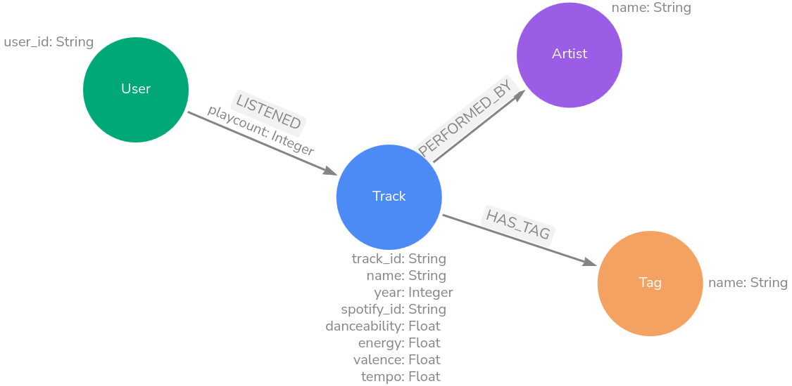

# Sistema de recomendação de músicas com base em grafos Neo4j

* Contexto do desafio: Criação de um sistema de recomendação musical baseada em grafos combinando metadados do [Million Song Dataset](https://www.kaggle.com/datasets/undefinenull/million-song-dataset-spotify-lastfm?select=User+Listening+History.csv);
+ Justificativa: Descoberta de similaridades entre usuários, artistas, tags e características de áudio;
+ Estratégia: amostragem de 1.000 registros de cada arquivo csv do dataset original.

## Modelagem do grafo

Para simplificar a modelagem do banco de dados e facilitar as consultas no **Neo4j Aura**, o modelo foi estruturado com **4 tipos de nós** e **3 tipos de relacionamentos**. A figura abaixo, criada usando [arrows.app](arrows.app) ilustra a modelagem:



### Nós (Labels):

* **`(:User)`**: representa os ouvintes do histórico de reprodução, identificado unicamente por `user_id` (`String`)[cite: 1].
* **`(:Track)`**: entidade central do catálogo musical, identificada por `track_id` (`String`), contendo metadados (`name`, `year`, `spotify_id`) e as quatro principais *audio features* (`danceability`, `energy`, `valence`, `tempo`)[cite: 1].
* **`(:Artist)`**: representa o artista ou banda responsável pela faixa, identificado por `name` (`String`)[cite: 1].
* **`(:Tag)`**: representa estilos, subgêneros e descritores temáticos extraídos das tags das músicas, identificado por `name` (`String`)[cite: 1].

### Relacionamentos (Relationship Types)

* **`(:User)-[:LISTENED {playcount: Integer}]->(:Track)`**: liga o usuário à música ouvida e registra a quantidade de reproduções (`playcount`)[cite: 1].
* **`(:Track)-[:PERFORMED_BY]->(:Artist)`**: conecta cada faixa ao seu respectivo artista[cite: 1].
* **`(:Track)-[:HAS_TAG]->(:Tag)`**: associa cada faixa às tags que descrevem seu estilo ou contexto[cite: 1].

### Representação do padrão em Cypher

O padrão abaixo ilustra a estrutura conceitual do grafo (com os tipos esperados como referência de modelagem):

```cypher
CREATE (:User {user_id: "String"})-[:LISTENED {playcount: "Integer"}]->(n0:Track {
  track_id: "String",
  name: "String",
  year: "Integer",
  spotify_id: "String",
  danceability: "Float",
  energy: "Float",
  valence: "Float",
  tempo: "Float"
})-[:HAS_TAG]->(:Tag {name: "String"}),
(n0)-[:PERFORMED_BY]->(:Artist {name: "String"})
