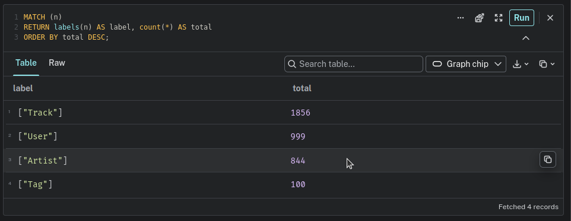
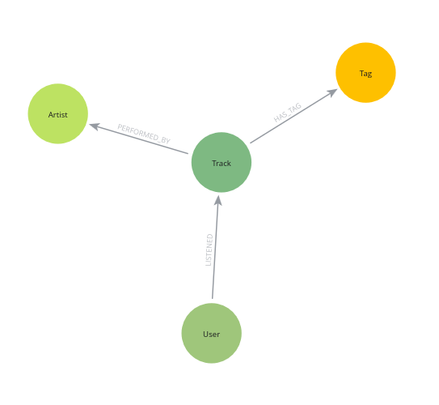
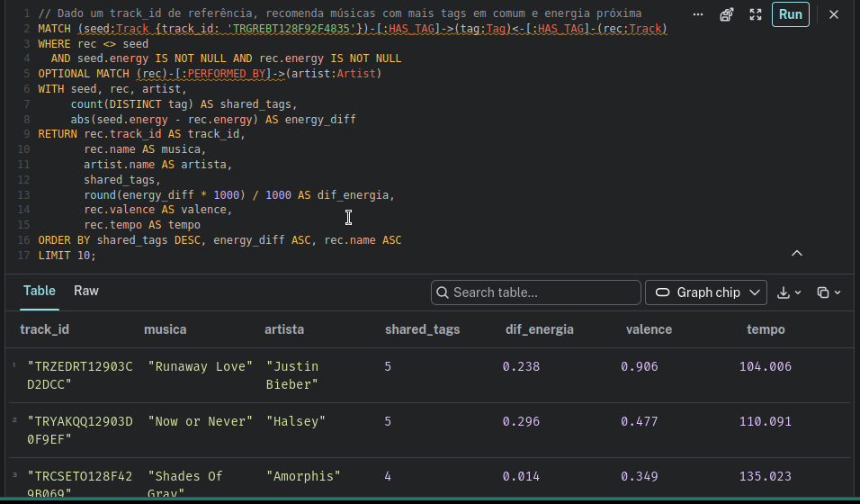
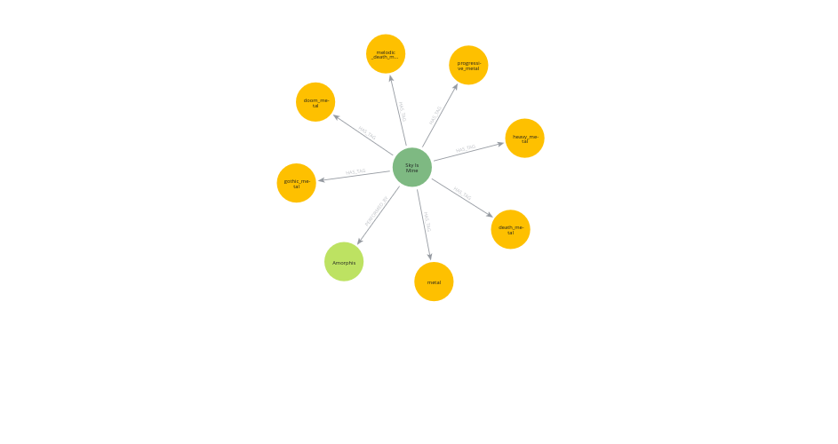
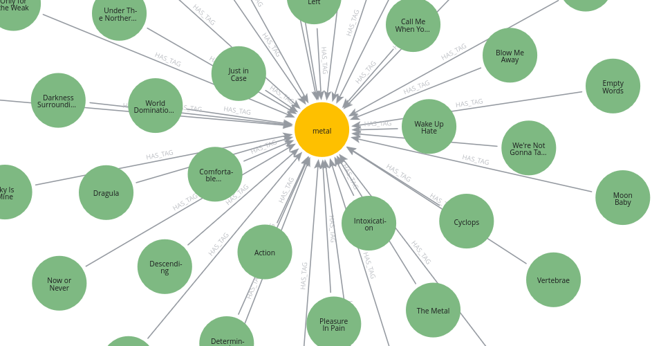

# Sistema de recomendação de músicas com base em grafos Neo4j

- **Contexto do desafio**: Criação de um sistema de recomendação musical baseado em grafos combinando metadados do [Million Song Dataset](https://www.kaggle.com/datasets/undefinenull/million-song-dataset-spotify-lastfm?select=User+Listening+History.csv).
- **Justificativa**: Descoberta de similaridades entre usuários, artistas, tags e características de áudio.
- **Estratégia**: Amostragem de 1.000 registros de cada arquivo CSV do dataset original.

## Modelagem do grafo

Para simplificar a modelagem do banco de dados e facilitar as consultas no **Neo4j Aura**, o modelo foi estruturado com **4 tipos de nós** e **3 tipos de relacionamentos**. A figura abaixo, criada usando [Arrows.app](https://arrows.app), ilustra a modelagem:


### Nós (Labels)

- **`(:User)`**: representa os ouvintes do histórico de reprodução, identificado unicamente por `user_id` (`String`).
- **`(:Track)`**: entidade central do catálogo musical, identificada por `track_id` (`String`), contendo metadados (`name`, `year`, `spotify_id`) e as quatro principais *audio features* (`danceability`, `energy`, `valence`, `tempo`).
- **`(:Artist)`**: representa o artista ou banda responsável pela faixa, identificado por `name` (`String`).
- **`(:Tag)`**: representa estilos, subgêneros e descritores temáticos extraídos das tags das músicas, identificado por `name` (`String`).

### Relacionamentos (Relationship Types)

- **`(:User)-[:LISTENED {playcount: Integer}]->(:Track)`**: liga o usuário à música ouvida e registra a quantidade de reproduções (`playcount`).
- **`(:Track)-[:PERFORMED_BY]->(:Artist)`**: conecta cada faixa ao seu respectivo artista.
- **`(:Track)-[:HAS_TAG]->(:Tag)`**: associa cada faixa às tags que descrevem seu estilo ou contexto.

### Representação do padrão em Cypher

O padrão abaixo ilustra a estrutura conceitual do grafo (com os tipos esperados como referência de modelagem):

```cypher
CREATE (:User {user_id: "String"})-[:LISTENED {playcount: "Integer"}]->(n0:Track {
  track_id: "String",
  name: "String",
  year: "Integer",
  spotify_id: "String",
  danceability: "Float",
  energy: "Float",
  valence: "Float",
  tempo: "Float"
})-[:HAS_TAG]->(:Tag {name: "String"}),
(n0)-[:PERFORMED_BY]->(:Artist {name: "String"})
```

## Constraints, índices e carga de dados no Neo4j Aura

Nesta etapa, preparamos o banco no **Neo4j Aura** para receber as amostras (`sample-music-info.csv` e `sample-user-listening-history.csv`) com segurança, sem duplicidades e com conversão correta de tipos.

### Constraints de unicidade no Neo4j Aura

```cypher
CREATE CONSTRAINT track_id_unique IF NOT EXISTS
FOR (t:Track) REQUIRE t.track_id IS UNIQUE;

CREATE CONSTRAINT artist_name_unique IF NOT EXISTS
FOR (a:Artist) REQUIRE a.name IS UNIQUE;

CREATE CONSTRAINT user_id_unique IF NOT EXISTS
FOR (u:User) REQUIRE u.user_id IS UNIQUE;

CREATE CONSTRAINT tag_name_unique IF NOT EXISTS
FOR (g:Tag) REQUIRE g.name IS UNIQUE;
```

### Carga das músicas, artistas e tags

```cypher
LOAD CSV WITH HEADERS FROM 'https://raw.githubusercontent.com/costandrad/neo4j-music-recomendation/refs/heads/main/data/sample-music-info.csv' AS row
WITH row
WHERE row.track_id IS NOT NULL AND trim(row.track_id) <> ''

MERGE (t:Track {track_id: trim(row.track_id)})
SET
  t.name = trim(row.name),
  t.spotify_id = CASE WHEN row.spotify_id IS NOT NULL AND trim(row.spotify_id) <> '' THEN trim(row.spotify_id) ELSE null END,
  t.year = CASE WHEN row.year IS NOT NULL AND trim(row.year) =~ '^-?[0-9]+$' THEN toInteger(trim(row.year)) ELSE null END,
  t.danceability = CASE WHEN row.danceability IS NOT NULL AND trim(row.danceability) <> '' THEN toFloat(trim(row.danceability)) ELSE null END,
  t.energy = CASE WHEN row.energy IS NOT NULL AND trim(row.energy) <> '' THEN toFloat(trim(row.energy)) ELSE null END,
  t.valence = CASE WHEN row.valence IS NOT NULL AND trim(row.valence) <> '' THEN toFloat(trim(row.valence)) ELSE null END,
  t.tempo = CASE WHEN row.tempo IS NOT NULL AND trim(row.tempo) <> '' THEN toFloat(trim(row.tempo)) ELSE null END

FOREACH (_ IN CASE WHEN row.artist IS NOT NULL AND trim(row.artist) <> '' THEN [1] ELSE [] END |
  MERGE (a:Artist {name: trim(row.artist)})
  MERGE (t)-[:PERFORMED_BY]->(a)
)

WITH t, row
WHERE row.tags IS NOT NULL AND trim(row.tags) <> ''
UNWIND split(row.tags, ',') AS rawTag
WITH t, toLower(trim(rawTag)) AS cleanTag
WHERE cleanTag <> ''
MERGE (tag:Tag {name: cleanTag})
MERGE (t)-[:HAS_TAG]->(tag);
```

### Carga de usuários e histórico de escuta

```cypher
LOAD CSV WITH HEADERS FROM 'https://raw.githubusercontent.com/costandrad/neo4j-music-recomendation/refs/heads/main/data/sample-user-listening-history.csv' AS row
WITH row
WHERE row.user_id IS NOT NULL AND trim(row.user_id) <> ''
  AND row.track_id IS NOT NULL AND trim(row.track_id) <> ''

MERGE (u:User {user_id: trim(row.user_id)})
MERGE (t:Track {track_id: trim(row.track_id)})
MERGE (u)-[r:LISTENED]->(t)
SET r.playcount = CASE
  WHEN row.playcount IS NOT NULL AND trim(row.playcount) =~ '^-?[0-9]+$'
  THEN toInteger(trim(row.playcount))
  ELSE 0
END;
```

### Validação dos volumes carregados

```cypher
MATCH (n)
RETURN labels(n) AS label, count(*) AS total
ORDER BY total DESC;
```



### Conferência visual do esquema de dados

```cypher
CALL db.schema.visualization()
```



## Queries de recomendação, evidências visuais e finalização

### Consulta 1 - Recomendação baseada em conteúdo (tags compartilhadas + similaridade de energia)

```cypher
// Dado um track_id de referência, recomenda músicas com mais tags em comum e energia próxima
MATCH (seed:Track {track_id: 'TRGREBT128F92F4835'})-[:HAS_TAG]->(tag:Tag)<-[:HAS_TAG]-(rec:Track)
WHERE rec <> seed
  AND seed.energy IS NOT NULL AND rec.energy IS NOT NULL
OPTIONAL MATCH (rec)-[:PERFORMED_BY]->(artist:Artist)
WITH seed, rec, artist,
     count(DISTINCT tag) AS shared_tags,
     abs(seed.energy - rec.energy) AS energy_diff
RETURN rec.track_id AS track_id,
       rec.name AS musica,
       artist.name AS artista,
       shared_tags,
       round(energy_diff * 1000) / 1000 AS dif_energia,
       rec.valence AS valence,
       rec.tempo AS tempo
ORDER BY shared_tags DESC, energy_diff ASC, rec.name ASC
LIMIT 10;
```



### Consulta 2 - Subgrafo completo de uma música (artista, tags e ouvintes)

```cypher
MATCH p1 = (a:Artist)<-[:PERFORMED_BY]-(t:Track {track_id: 'TRGREBT128F92F4835'})-[:HAS_TAG]->(g:Tag)
OPTIONAL MATCH p2 = (u:User)-[l:LISTENED]->(t)
RETURN p1, p2
LIMIT 50;
```



### Consulta 3 - Grafo de recomendação por tags compartilhadas

```cypher
MATCH p = (seed:Track {track_id: 'TRGREBT128F92F4835'})-[:HAS_TAG]->(tag:Tag)<-[:HAS_TAG]-(rec:Track)
WHERE rec <> seed
RETURN p
LIMIT 40;
```



## Conclusão e próximos passos

Este projeto demonstra como um grafo de propriedades no **Neo4j Aura** permite integrar metadados musicais, *audio features*, tags e hábitos de escuta em um modelo enxuto e intuitivo, facilitando tanto a exploração visual quanto consultas de recomendação baseadas em conexões. Mesmo partindo de uma amostra de 1.000 registros por arquivo para validar o pipeline de carga, conversão de tipos e travessias em Cypher, a arquitetura está pronta para escalar para volumes maiores do dataset, evoluir para recomendações híbridas ponderadas por `playcount` e similaridade acústica, e servir como base prática para o desafio de projeto na DIO.